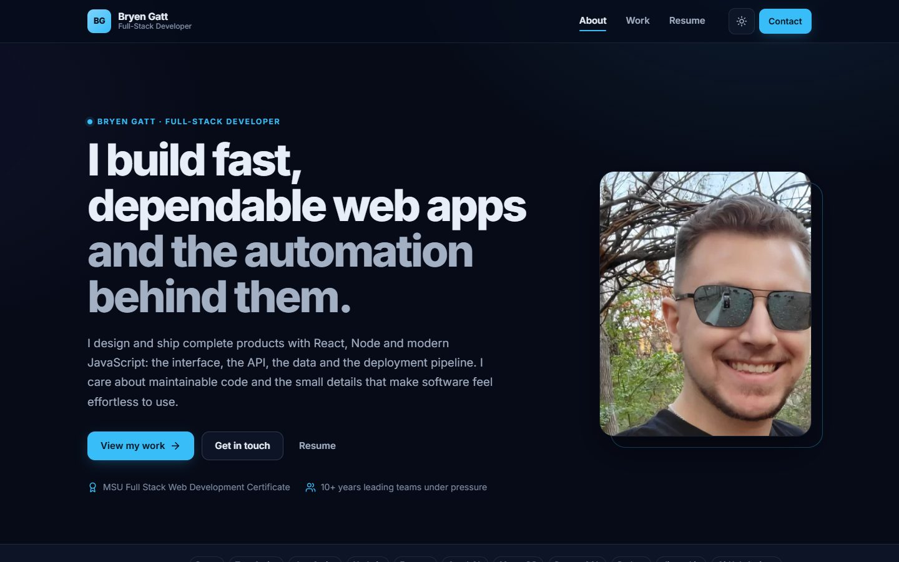
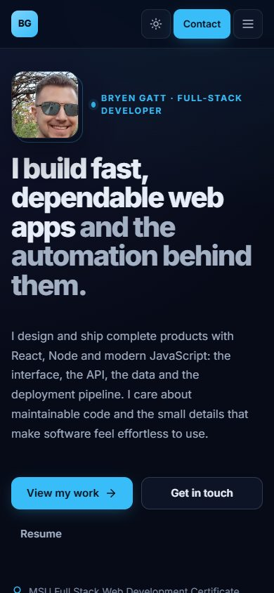

# Bryen Gatt · Developer Portfolio

The source for my live developer portfolio: real projects, case studies with the honest story behind each one, a one-page résumé and a working contact form. Built with React and Vite.

**Live site:** [one2-react-portfolio.onrender.com](https://one2-react-portfolio.onrender.com) · **Résumé:** [/resume](https://one2-react-portfolio.onrender.com/resume) · **LinkedIn:** [bryen-gatt](https://www.linkedin.com/in/bryen-gatt-8b3b69321)

<p>
  
  
</p>

More screenshots: [Work page](docs/screenshots/work-desktop.jpg) · [Case study](docs/screenshots/case-study-desktop.jpg). All four were captured from the live site.

> The canonical site runs on Render's free tier, so the first visit after a quiet spell can take up to a minute to wake up. Some linked project demos run on the same tier and cold-start the same way. A Netlify mirror (`bryensreactportfolio.netlify.app`) serves the same build.

## About me

I spent more than a decade running kitchen lines as a lead and team supervisor: hard deadlines, training new people, and owning the result when service gets busy. I build software with the same habits. I plan the work, communicate early and finish what I start. This site is where that work lives.

## Start here

Short on time? Read one case study. Each covers the problem, what I built, the decisions and the outcome.

| Project | What it shows | Links |
|---|---|---|
| **Zombies Hub 2.0** | Seven separate guide sites rebuilt as one React app with CI-gated deploys. Solo build. | [Case study](https://one2-react-portfolio.onrender.com/work/zombies-hub-2) · [Live](https://zombies-hub-2-0.onrender.com/) · [Source](https://github.com/PHTMGatt/Zombies-Hub-2.0) |
| **Fairway Finder** | MERN + GraphQL golf trip planner. Primary developer on a five-person team. | [Case study](https://one2-react-portfolio.onrender.com/work/fairway-finder) · [Live](https://fairway-finder.onrender.com) · [Source](https://github.com/PHTMGatt/Fairway-Finder) |
| **Mithrandir** | A personal command center that coordinates Claude Code workers across repositories, with MongoDB memory. | [Case study](https://one2-react-portfolio.onrender.com/work/mithrandir) (private source) |
| **Clash of Clans Discord Suite** | Two Discord bots (War Oracle and Legacy Bot) and a Raspberry Pi installer that sets each up as its own systemd service. Physical Pi deployment is not yet verified. | [Case study](https://one2-react-portfolio.onrender.com/work/clash-automation) · [Source](https://github.com/PHTMGatt/War-Oracle-Bot) |

Every other project is on the [Work page](https://one2-react-portfolio.onrender.com/work), with its source first, a live demo where one exists, and an honest status label (legacy, paused, inactive).

## What's in the site

- **Work:** every project, filterable by type, plus an archive of retired apps
- **Case studies:** problem, approach, outcome and current status, without invented capabilities
- **Résumé:** an on-page résumé and a one-page PDF export with working links
- **Contact:** a validated form that sends through EmailJS, with an optional Middle-earth mode
- **Details:** light and dark themes, a skip link and full keyboard support, reduced-motion support, responsive layouts from phone to desktop, share metadata for every route, and a strict Content-Security-Policy with the usual security headers on both hosts

## Stack

| Area | Tools |
|---|---|
| UI | React 19, React Router 7, hand-written CSS (no UI framework) |
| Build | Vite 6, Sharp for responsive WebP artwork, Terser |
| Features | EmailJS (contact), jsPDF (résumé export), lucide-react and react-icons |
| Quality | ESLint, Node's built-in test runner, Playwright browser checks, a bundle-size budget |
| CI/CD | GitHub Actions (validate and security pipelines), Render hosting with a Netlify mirror and deploy previews |

## Run it locally

Requires Node.js 20.9 or newer (Sharp 0.35 needs it); Node 22 recommended.

```bash
git clone https://github.com/PHTMGatt/12-React-Portfolio.git
cd 12-React-Portfolio
npm ci
npm run dev        # http://localhost:5173
```

`npm run dev` generates the responsive artwork first, so the first start takes a few extra seconds. If you change an image while the server is running, run `npm run artwork:generate` or restart it.

No environment variables are needed. The contact form sends through the EmailJS service configured in `src/utils/Email.js`.

## Test and build

```bash
npm run lint           # ESLint
npm test               # unit and regression tests: data, résumé PDF, artwork, route metadata
npm run build          # production build into dist/
npm run check:bundle   # fails if the main bundle grows past 100 kB gzipped
```

Browser checks run against a production build, in two terminals. They use Playwright's Chromium, or fall back to an installed Google Chrome:

```bash
npx playwright install chromium                    # first time only, if Chrome isn't installed
npm run preview -- --host 127.0.0.1 --port 4174    # terminal 1, after npm run build
npm run test:browser                               # terminal 2
```

They cover every route at desktop, tablet and mobile widths in both themes: one `h1` and one `main` per page, no horizontal overflow, no console errors, skip-link focus, the theme toggle, a mocked contact send (no real email goes out), the résumé PDF download, artwork delivery and font loading.

## How it's built

```
src/
  pages/        one folder per route: About (home), Portfolio (work), CaseStudy, Resume, Contact, NotFound
  components/   Nav, Footer, ProjectCard, FeaturedStudy, ProjectImage
  data/         projects, case studies, profile and page metadata, kept out of the components
  assets/       self-hosted fonts, and photos (the single artwork library)
scripts/        artwork generation, route metadata, tests and browser checks
```

- **Fast first load.** Only the home page ships in the main bundle (about 98 kB gzipped, mostly React and the router). Every other route, the footer and the 404 page load on demand, and the PDF library loads only when you click Download.
- **Right-sized images.** Originals stay in `src/assets/photos/`. The build writes 480, 800 and 1280 px WebP versions (up to 1920 px for case studies) into the git-ignored `src/assets/photos/generated/` folder, never upscales, and each image declares `sizes` for its layout.
- **Shareable routes.** Every route gets its own title, description and canonical link at build time, so shared links preview correctly before any JavaScript runs.
- **Self-hosted fonts.** Typography loads from the site itself, with no third-party font service.

## Continuous integration

Every push runs `.github/workflows/validate.yml`: lint, tests, build, the bundle budget, then the full Playwright browser suite. A separate security pipeline runs dependency audits and secret scanning.

## Contact

The quickest way to reach me is the [contact form](https://one2-react-portfolio.onrender.com/contact) or [PHTMGatt@gmail.com](mailto:PHTMGatt@gmail.com).
