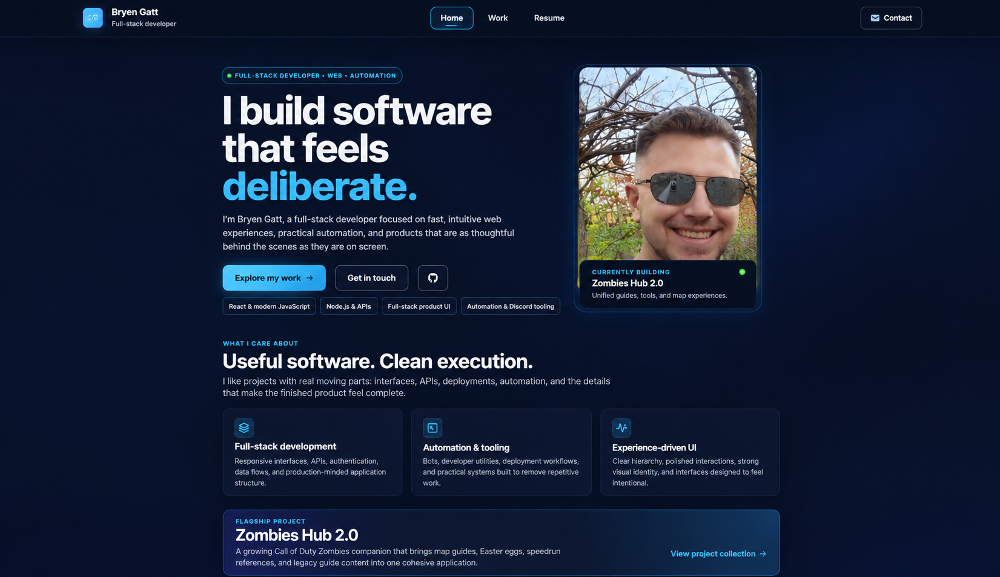

# Bryen Gatt — Developer Portfolio



The source for my live developer portfolio: real projects, in-depth case studies, a downloadable one-page résumé and a working contact form, built with React and Vite.

**Live site:** https://one2-react-portfolio.onrender.com

> Hosted on Render's free tier, so the first visit after a quiet spell can take up to a minute to wake up. Some linked project demos (for example the Weather App) are on the same tier and cold-start the same way.

## What it is

This is the portfolio itself, not a template. It is built to help recruiters and hiring teams see real work quickly:

- **Work:** every project with GitHub source first, a live demo where one exists, and an honest status label (legacy, paused, inactive)
- **Case studies:** problem, approach, decisions and outcome for selected projects, without invented capabilities
- **Résumé:** an on-page résumé plus a one-page PDF export with working links
- **Contact:** a validated form that sends through EmailJS
- **Polish:** light and dark themes, keyboard navigation with a skip link, responsive layouts from phone to desktop, and share metadata for every route

## Stack

| Area | Tools |
|---|---|
| UI | React 19, React Router 7, custom CSS |
| Build | Vite 6, Sharp (responsive WebP artwork) |
| Features | EmailJS (contact), jsPDF (résumé export), lucide-react and react-icons |
| Quality | ESLint, Node's built-in test runner, Playwright browser checks, a bundle-size budget |
| CI/CD | GitHub Actions (validate + security pipeline), Render hosting |

## Run it locally

Requires Node.js 20 or newer.

```bash
npm ci
npm run dev        # http://localhost:5173
```

## Test and build

```bash
npm run lint           # ESLint
npm test               # unit and regression tests (data, résumé PDF, artwork, metadata)
npm run build          # production build into dist/
npm run check:bundle   # fails if the main bundle grows past 100 kB gzipped
```

Browser checks run against a production preview:

```bash
npm run preview -- --host 127.0.0.1 --port 4174
npm run test:browser   # in a second terminal
```

They cover every route at desktop, tablet and mobile widths in both themes: one `h1` and `main` per page, no horizontal overflow, no console errors, skip-link focus, theme toggle, a mocked contact send (no real email), the résumé PDF download, artwork delivery and font loading.

## Performance

Only the home page ships in the main bundle; every other route, the footer and the 404 page load on demand. Artwork originals stay in `src/assets/photos/`, and the build generates 480/800/1280 px WebP variants (plus a larger one, capped at 1920 px, for case studies) in the git-ignored `src/assets/photos/generated/` folder. Images never upscale, and `ProjectImage` sets layout-specific `sizes` so browsers pick the right file for the screen.

If you change artwork while the dev server is running, run `npm run artwork:generate` or restart the server.

## Continuous integration

Every push runs `.github/workflows/validate.yml`: lint, tests, build, the bundle budget, then the full Playwright browser suite. A separate security pipeline runs dependency audits and secret scanning.
