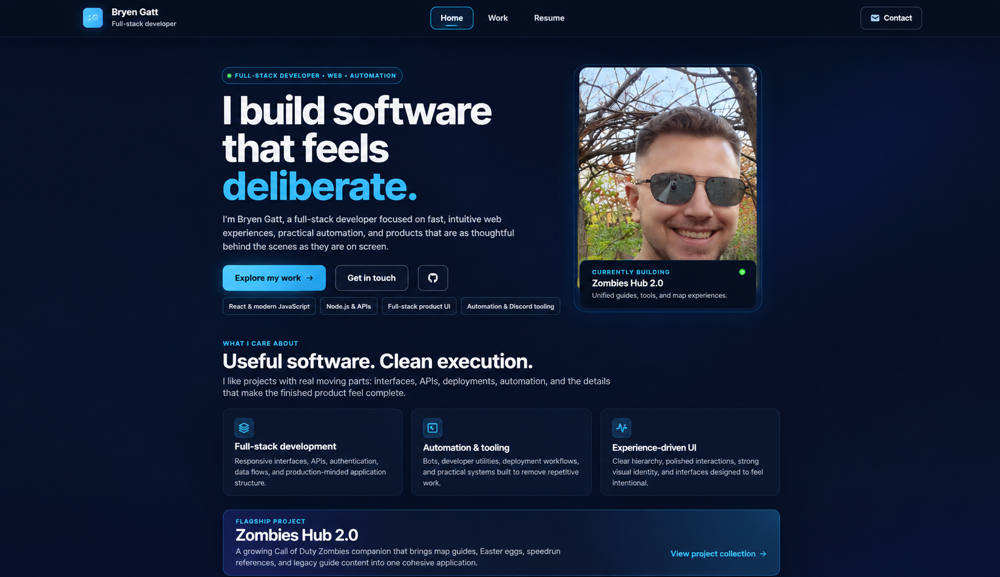

# 🚀 **React Portfolio**

---

## 🌟 **Overview**

This **React-based portfolio** showcases my web development projects and skills. It serves as a professional platform for potential employers and fellow developers to explore my creations. The portfolio is fully responsive, interactive, and deployed live on Render for easy accessibility.

**🔗 [View Live Portfolio](https://one2-react-portfolio.onrender.com)**

---

## ✨ **Features**

- Single-page application (**SPA**) with seamless navigation using React Router.
- Clean, responsive, and mobile-friendly design.
- **Portfolio section** showcasing projects with detailed previews and direct links.
- Interactive **contact form** with form validation.
- Dedicated **Resume section** with downloadable resume and listed proficiencies.
- Footer with professional links (**GitHub**, **LinkedIn**, etc.).

---

## 🛠️ **Built With**

- React
- React Router
- CSS (custom styling for polished UI)
- Deployed with Render

---

## 🎯 **Highlighted Projects**

Each project in the portfolio includes:

- **GitHub repository** link first, for the source and project history
- **Live demo** link second, only where a deployment exists
- The approved canonical visual from `src/assets/photos/`, shared with the matching repository README where an approved image exists
- A status label for **Legacy**, **Paused** or **Inactive** projects

---

## 📄 **Resume & Proficiencies**

The resume section features a downloadable PDF resume and highlights key proficiencies, including:

- HTML5 & CSS3
- JavaScript (ES6+)
- React & React Router
- Responsive & Mobile-first Design
- RESTful APIs
- Node.js
- Git & GitHub

---

## 🎨 **Design & UI/UX**

The portfolio features a modern, aesthetically pleasing design with a carefully chosen color palette, smooth gradients, and clear typography to ensure readability and intuitive navigation across all devices.

---

## 🌐 **Deployment**

The portfolio is hosted on Render for rapid, reliable, and global access. Continuous deployment ensures the latest updates are instantly available.

**🔗 [Live Application](https://one2-react-portfolio.onrender.com)**

---

## 📂 **Repository Structure & Best Practices**

The GitHub repository maintains best practices including:

- Clear and consistent **file naming**.
- Structured **component organization**.
- Meaningful **commit messages**.
- Thorough **documentation and comments**.

---

🌟 **Keep Exploring! Your feedback and suggestions are warmly welcomed. Happy coding!** 🚀

## Project artwork delivery

Approved originals remain in `src/assets/photos/`. `npm run dev`, `npm run start:dev`, and `npm run build` generate WebP delivery variants in the ignored `src/assets/photos/generated/` directory. Do not edit or commit those derivatives. After changing artwork while the dev server is running, run `npm run artwork:generate` (or restart the server).

The generator preserves aspect ratios, never enlarges an original, and provides 480/800/1280-pixel candidates plus a larger candidate capped at 1920 pixels for case studies. Source artwork remains unchanged, including the approved Banking and Clash images. `ProjectImage` uses the existing layout-specific `sizes` values to select a candidate for the viewport and pixel density.

Run `npm test`, `npm run lint`, and `npm run build`. With the production preview on port 4174, `npm run test:browser` checks pages, artwork decoding, and mobile image selection at 1×/2×/3× density, including a 1 MB initial Work-image budget.
